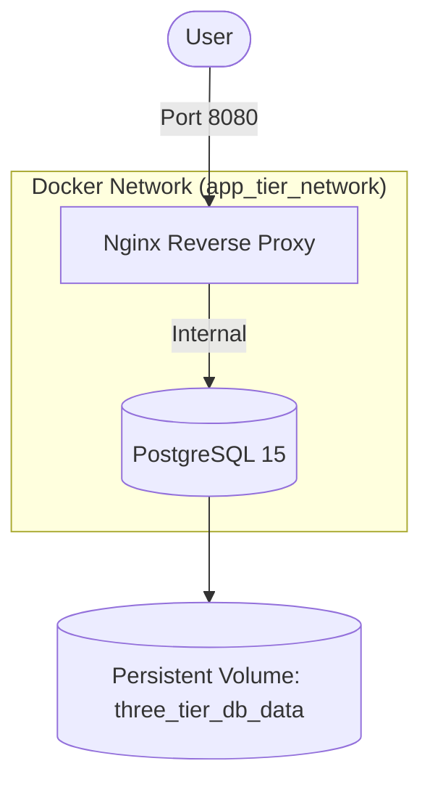

# DevOpsTerraform

Automated Infrastructure as Code projects demonstrating production-grade Terraform patterns for containerized applications.

## 🏗️ Projects

### [ThreeTieredWebApp](./ThreeTieredWebApp) — **Main Project**
A complete **3-tier architecture** deployed with Terraform and Docker:
- **Web Tier**: Nginx reverse proxy (port 8080)
- **Database Tier**: PostgreSQL 15-alpine with persistent volume
- **Networking**: Isolated Docker bridge network for secure inter-tier communication
- **Secrets Management**: Typed variables (`db_password` marked sensitive), no credentials in source

**Single-command deployment**: `terraform apply` provisions the full stack reproducibly.



**Quick Start**:
```bash
cd ThreeTieredWebApp
cp terraform.tfvars.example terraform.tfvars  # edit db_password
terraform init
terraform apply
# Visit http://localhost:8080
```

---

### [SimpleWebServerTerraform](./SimpleWebServerTerraform)
A minimal **Nginx web server** deployment for learning Terraform + Docker basics:
- Pulls `nginx:latest` from Docker Hub
- Runs container with port mapping (8080→80)
- Ideal for first IaC steps

---

## 🛠️ Prerequisites
- [Terraform](https://www.terraform.io/downloads) ≥ 1.0
- [Docker](https://www.docker.com/products/docker-desktop/) running
- Bash / PowerShell terminal

---

## 🎯 Learning Outcomes
- Modular Terraform structure (root + modules/)
- Docker provider for local container orchestration
- Sensitive variable handling & `.tfvars` pattern
- Persistent volumes for stateful services
- Reproducible infrastructure from code

---

## 📄 License
Educational / learning purposes. No warranty provided.
