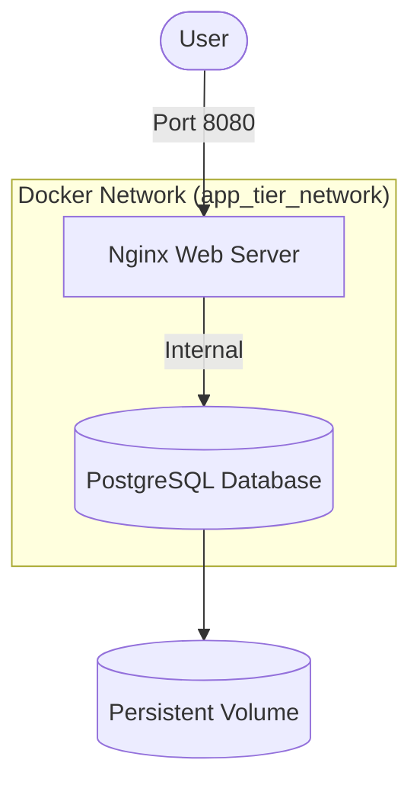

# 🚀 ThreeTieredWebApp

A robust and scalable three-tier architecture deployment using **Terraform** and **Docker**. This project automates the setup of a web tier, a database tier, and their underlying network infrastructure, ensuring a seamless and reproducible environment.

---

## 🏗 Architecture Overview

The application is structured into two main logical tiers connected via a dedicated Docker network:

- **🌐 Web Tier**: An Nginx web server acting as the front-facing component.
- **🗄️ Database Tier**: A PostgreSQL database (v15-alpine) with a persistent volume for data durability.
- **🔌 Networking**: A shared Docker bridge network allowing secure internal communication between tiers.



---

## 🛠 Prerequisites

Before you begin, ensure you have the following installed:

- [Terraform](https://www.terraform.io/downloads) (>= 1.0.0)
- [Docker](https://www.docker.com/products/docker-desktop)
- A terminal with `bash` or `PowerShell` access

---

## 🚀 Getting Started

Follow these steps to deploy the application:

1. **Initialize Terraform**:
   ```bash
   terraform init
   ```

2. **Configure Variables**:
   Create a `terraform.tfvars` file (or edit the existing one) to set your sensitive data:
   ```hcl
   db_password = "your_secure_password"
   web_port    = 8080
   ```

3. **Plan and Apply**:
   ```bash
   terraform apply
   ```

4. **Verify Deployment**:
   Open your browser and navigate to `http://localhost:8080`.

---

## ⚙️ Configuration

### Root Variables

| Name | Description | Type | Default |
| :--- | :---------- | :--- | :------ |
| `db_password` | Password for the PostgreSQL database (Sensitive) | `string` | - |
| `db_volume_name` | Name for the Docker volume used for persistence | `string` | `three_tier_db_data` |
| `web_port` | External port for the Nginx web server | `number` | `8080` |

### Modules

- **Web Tier**: Located in `./modules/web_tier`. Manages Nginx image and container.
- **Database Tier**: Located in `./modules/db_tier`. Manages Postgres image, container, and persistent volumes.

---

## 🧹 Cleanup

To tear down the infrastructure and remove containers/volumes:
```bash
terraform destroy
```

---

> [!NOTE]
> This project is designed for demonstration and development purposes. For production use, consider using a cloud provider (AWS/GCP/Azure) and robust secrets management.
